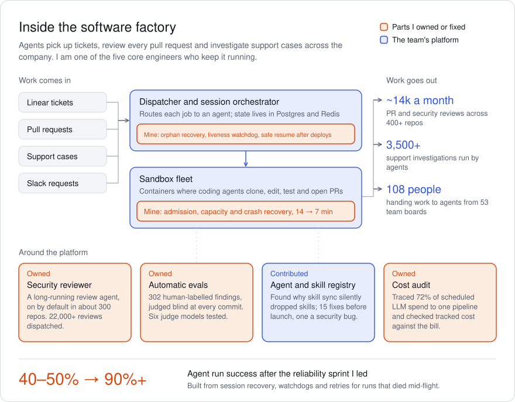
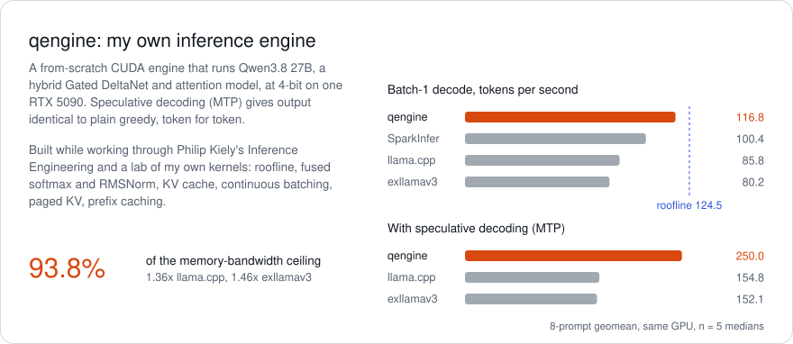
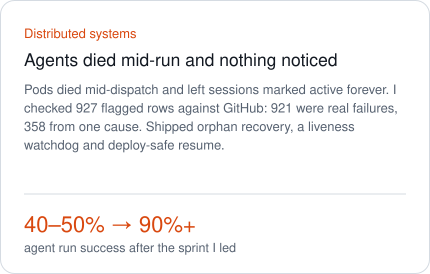
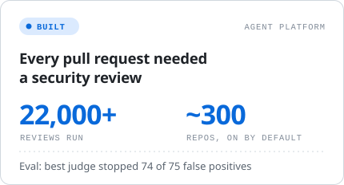
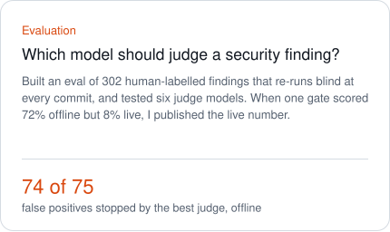
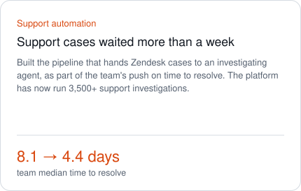
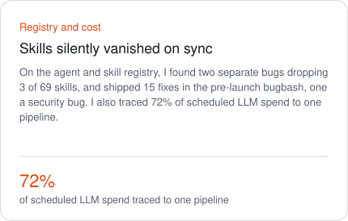
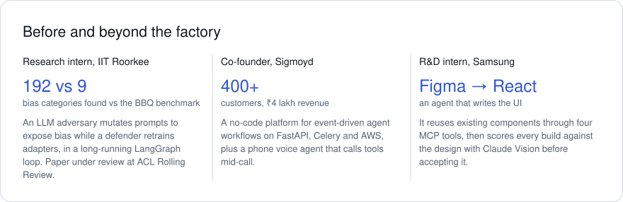
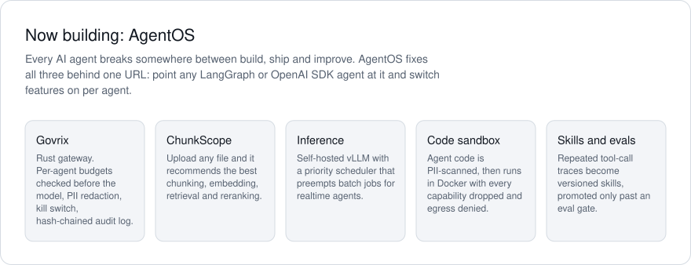

<a href="https://manaschoudhary.dev"><picture><source media="(prefers-color-scheme: dark)" srcset="./assets/hero-dark.svg"></picture></a>

  <a href="https://manaschoudhary.dev"><b>manaschoudhary.dev</b></a> &nbsp;·&nbsp;
  <a href="https://manaschoudhary.dev/work">Work timeline</a> &nbsp;·&nbsp;
  <a href="mailto:manas24102@iiitnr.edu.in">manas24102@iiitnr.edu.in</a> &nbsp;·&nbsp;
  <a href="https://linkedin.com/in/-manas-choudhary-">LinkedIn</a>

<a href="https://manaschoudhary.dev/work"><picture><source media="(prefers-color-scheme: dark)" srcset="./assets/factory-dark.svg"></picture></a>

<a href="https://github.com/manaspros/qengine"><picture><source media="(prefers-color-scheme: dark)" srcset="./assets/qengine-dark.svg"></picture></a>

### Where I went deep

<picture><source media="(prefers-color-scheme: dark)" srcset="./assets/card-reliability-dark.svg"></picture>
<picture><source media="(prefers-color-scheme: dark)" srcset="./assets/card-security-dark.svg"></picture>

<picture><source media="(prefers-color-scheme: dark)" srcset="./assets/card-evals-dark.svg"></picture>
<picture><source media="(prefers-color-scheme: dark)" srcset="./assets/card-dashboard-dark.svg"></picture>

<picture><source media="(prefers-color-scheme: dark)" srcset="./assets/card-support-dark.svg"></picture>
<picture><source media="(prefers-color-scheme: dark)" srcset="./assets/card-registry-dark.svg"></picture>

<picture><source media="(prefers-color-scheme: dark)" srcset="./assets/beyond-dark.svg"></picture>

<a href="https://manaschoudhary.dev/projects/agent-os"><picture><source media="(prefers-color-scheme: dark)" srcset="./assets/agentos-dark.svg"></picture></a>

  <a href="https://youtu.be/I9KVPHxZsVw"><b>Watch the AgentOS demo</b></a> &nbsp;·&nbsp;
  <a href="https://manaschoudhary.dev/projects/agent-os">Architecture</a> &nbsp;·&nbsp;
  <a href="https://manaschoudhary.dev/projects/agent-os/incidents">Incident write-ups</a> &nbsp;·&nbsp;
  <a href="https://govrix.dev">Govrix</a> &nbsp;·&nbsp;
  <a href="https://github.com/manaspros/chunkscope">ChunkScope</a>

### What I work with

| | |
|---|---|
| **Languages** | Python, TypeScript, Rust, Go, C++, CUDA, SQL |
| **Agents and LLMs** | LangGraph, multi-agent systems, MCP, Claude Agent SDK, LLM evaluation (LLM-as-judge, RAGAS), RAG, hybrid search (BM25, pgvector), vLLM, speculative decoding, KV cache and paged attention, Triton, PyTorch, Hugging Face |
| **Backend and distributed systems** | FastAPI, Node.js, Celery, Tokio, WebSockets, event-driven systems, API gateways, session recovery, rate limiting |
| **Data** | PostgreSQL, pgvector, Redis, TimescaleDB, DynamoDB, MongoDB |
| **Infrastructure** | AWS, Kubernetes, Docker, Cloudflare Workers and Durable Objects, Prometheus, Grafana, OpenTelemetry, CI/CD |

1st place, Hack-a-Sol 2025 (AI/ML track) &nbsp;·&nbsp; Rank 9, Amazon ML Challenge 2026 &nbsp;·&nbsp; B.Tech Data Science and AI, IIIT Naya Raipur

