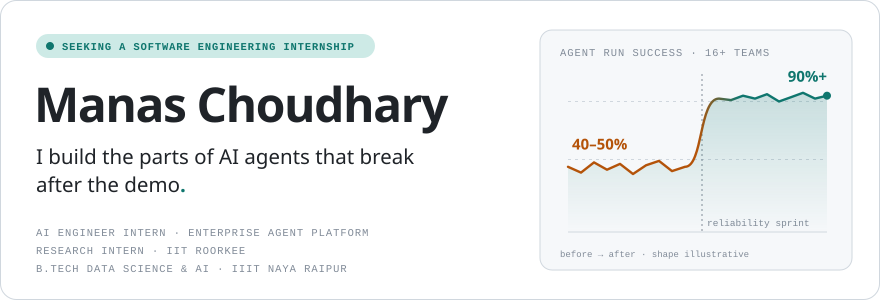
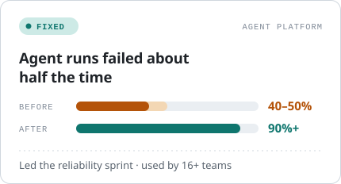
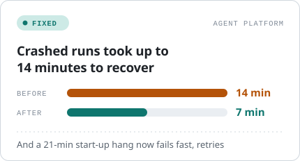

<a href="https://manaschoudhary.dev"><picture><source media="(prefers-color-scheme: dark)" srcset="./assets/hero-dark.svg"></picture></a>

  <a href="https://manaschoudhary.dev"><b>manaschoudhary.dev</b></a> &nbsp;·&nbsp;
  <a href="mailto:manas24102@iiitnr.edu.in">manas24102@iiitnr.edu.in</a> &nbsp;·&nbsp;
  <a href="https://linkedin.com/in/-manas-choudhary-">LinkedIn</a> &nbsp;·&nbsp;
  <a href="https://manaschoudhary.dev/work">Work timeline</a>

### Problems I've worked on

<a href="https://manaschoudhary.dev/work"><picture><source media="(prefers-color-scheme: dark)" srcset="./assets/card-runs-dark.svg"></picture></a>
<a href="https://manaschoudhary.dev/work"><picture><source media="(prefers-color-scheme: dark)" srcset="./assets/card-recovery-dark.svg"></picture></a>

<a href="https://manaschoudhary.dev/work"><picture><source media="(prefers-color-scheme: dark)" srcset="./assets/card-dashboard-dark.svg"></picture></a>
<a href="https://manaschoudhary.dev/work"><picture><source media="(prefers-color-scheme: dark)" srcset="./assets/card-security-dark.svg"></picture></a>

<picture><source media="(prefers-color-scheme: dark)" srcset="./assets/card-bias-dark.svg"></picture>
<a href="https://www.sigmoyd.in/"><picture><source media="(prefers-color-scheme: dark)" srcset="./assets/card-sigmoyd-dark.svg"></picture></a>

### What I'm building

<a href="https://manaschoudhary.dev/projects/agent-os"><picture><source media="(prefers-color-scheme: dark)" srcset="./assets/agentos-dark.svg"></picture></a>

  <a href="https://youtu.be/I9KVPHxZsVw"><b>Watch the demo</b></a> &nbsp;·&nbsp;
  <a href="https://manaschoudhary.dev/projects/agent-os">Architecture</a> &nbsp;·&nbsp;
  <a href="https://manaschoudhary.dev/projects/agent-os/incidents">Incident write-ups</a> &nbsp;·&nbsp;
  <a href="https://govrix.dev">Govrix</a> &nbsp;·&nbsp;
  <a href="https://github.com/manaspros/chunkscope">ChunkScope</a>

### Tools I can be quizzed on

`Python` `TypeScript` `Rust` `LangGraph` `MCP` `vLLM` `FastAPI` `PostgreSQL` `pgvector` `Redis` `Docker` `Kubernetes` `AWS`

1st place, Hack-a-Sol 2025 (AI/ML track) &nbsp;·&nbsp; Rank 9, Amazon ML Challenge 2026 &nbsp;·&nbsp; Also built a Figma-to-React agent at Samsung R&amp;D and a ROS2 robot stack at IIT Jodhpur

